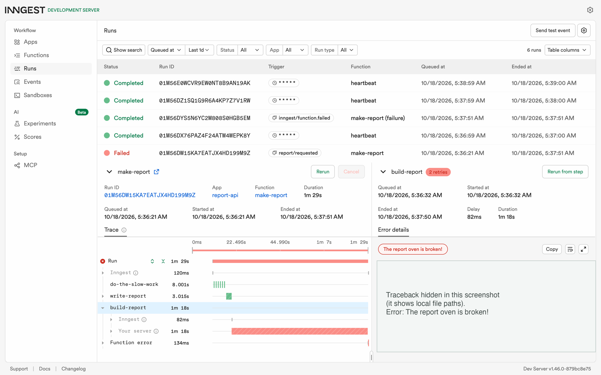
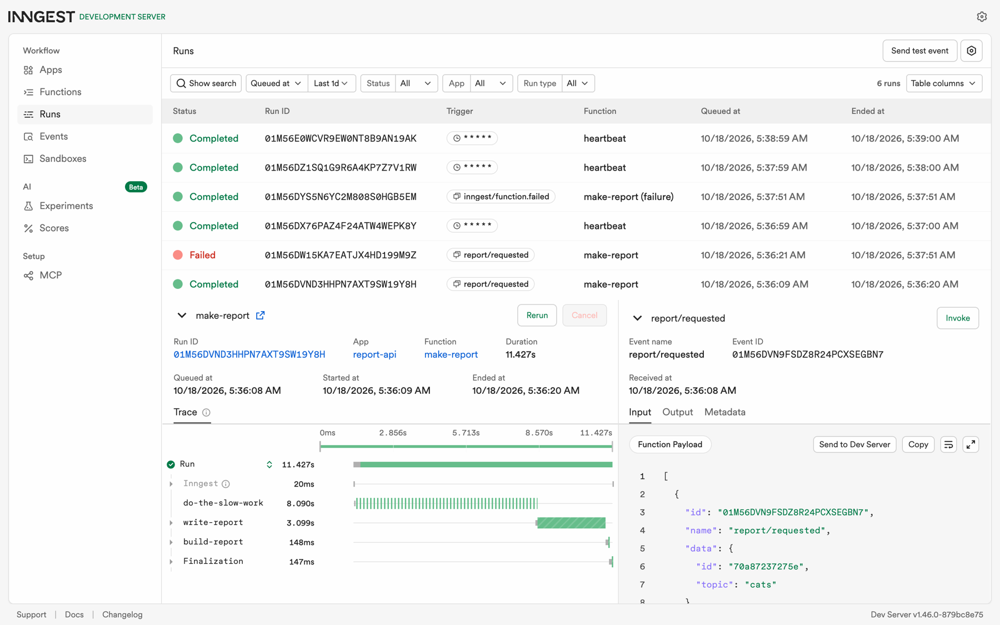

# Report API: your first background job

A small FastAPI service whose slow work runs in an [Inngest](https://www.inngest.com/) background job.
`POST /reports` answers **202 Accepted** at once, a background function does the ~8-second work, and
`GET /reports/{id}` reports the status: `pending`, then `done` with the result (or `failed`). A cron
function runs every minute with no request at all.

FlyRank AI Internship, Backend AI Engineering track, Week 7: BE-06 "Your first background job"
(A7 in the brief). Python lane: FastAPI + the Inngest Python SDK + the Inngest Dev Server.



## Run it

Requires Python 3.10+ and Node.js (for `npx`, which starts the Inngest Dev Server).

```bash
python3 -m venv .venv
source .venv/bin/activate
pip install -r requirements.txt
```

Then the two commands, each in its own terminal:

```bash
uvicorn app.main:app --port 8000                                  # terminal 1: the API
npx inngest-cli@latest dev -u http://localhost:8000/api/inngest   # terminal 2: the Dev Server
```

Open the dashboard at http://localhost:8288 and ask for a report:

```bash
curl -X POST http://localhost:8000/reports -H "Content-Type: application/json" -d '{"topic":"cats"}'
curl http://localhost:8000/reports/<id>   # pending now, done about 11 seconds later
```

Tested with Inngest Dev Server 1.46.0. The API runs against the local Dev Server by default; no Inngest
account or keys are needed.

## Endpoints

| Method and path | What it does | Answers |
|---|---|---|
| `GET /health` | Health check | `200 {"status": "ok"}` |
| `POST /reports` | Body `{"topic": "cats"}`. Saves the report as `pending`, sends the `report/requested` event and returns at once. No slow work happens here | `202 {"id", "status": "pending"}` · `400` missing, empty or too long topic (no event sent) |
| `GET /reports/{id}` | The status endpoint: the saved report | `200` `pending` → `done` + `result` (or `failed` + `error`) · `404` unknown id |
| `/api/inngest` | Where the Dev Server discovers and calls the functions | used by Inngest |

## Functions

| Function | Trigger | What it does |
|---|---|---|
| `say-hello` | event `test/hello` | Sleeps 5 s (`step.sleep`), returns "Hello from the background!" (Stage 1) |
| `make-report` | event `report/requested` | Steps: `do-the-slow-work` (8 s `step.sleep`, a stand-in for real slow work), `write-report` (~3 s of work), `build-report` (saves the result, status `done`). `retries=2`, at most 2 runs at once, idempotent |
| `make-report` failure handler | Inngest, after the last retry fails | Marks the report `failed` and logs an `ALERT` line |
| `heartbeat` | cron `* * * * *` (every minute) | Logs one summary line: how many reports are pending, done and failed |

Topic `"fail"` makes `build-report` raise "The report oven is broken!", to show the retries.

## Proof: 202, then pending, then done

A fresh run on 18 October 2026 (the 400, 404 and failure are in the same session):

```text
$ time curl -i -X POST http://localhost:8000/reports -H "Content-Type: application/json" -d '{"topic":"cats"}'
HTTP/1.1 202 Accepted
content-length: 40
content-type: application/json

{"id":"70a87237275e","status":"pending"}

real	0m0.052s

$ curl -s http://localhost:8000/reports/70a87237275e          # straight away
{"id":"70a87237275e","topic":"cats","status":"pending","created_at":"2026-10-18T02:36:08+00:00"}

$ curl -s http://localhost:8000/reports/70a87237275e          # 12 seconds later
{"id":"70a87237275e","topic":"cats","status":"done","created_at":"2026-10-18T02:36:08+00:00","result":{"title":"Report: cats","summary":"A short report about cats, made by a background job.","body":"Cats: three key points, written by the make-report job.","finished_at":"2026-10-18T02:36:20+00:00"},"built_by_run":"01M56DVND3HHPN7AXT9SW19Y8H"}

$ curl -i -X POST http://localhost:8000/reports -H "Content-Type: application/json" -d '{}'
HTTP/1.1 400 Bad Request
{"detail":"topic is required and must be a non-empty string"}

$ curl -i http://localhost:8000/reports/unknown
HTTP/1.1 404 Not Found
{"detail":"Report not found"}

$ curl -s -X POST http://localhost:8000/reports -H "Content-Type: application/json" -d '{"topic":"fail"}'
{"id":"cb4528b412a5","status":"pending"}

$ curl -s http://localhost:8000/reports/cb4528b412a5          # after 3 attempts
{"id":"cb4528b412a5","topic":"fail","status":"failed","created_at":"2026-10-18T02:36:21+00:00","error":"The report oven is broken!","failed_at":"2026-10-18T02:37:51+00:00"}

API terminal (heartbeat every minute, and the alert):
2026-10-18 05:37:00,016 INFO report-api: heartbeat: 1 pending, 1 done, 0 failed
2026-10-18 05:37:51,170 ERROR report-api: ALERT: report cb4528b412a5 (topic 'fail') failed after 3 attempts: The report oven is broken!
2026-10-18 05:38:00,019 INFO report-api: heartbeat: 0 pending, 1 done, 1 failed
```

The POST answered in 52 ms; the report turned `done` about 11 seconds later (8 s sleep + 3 s writing).



## Stage 3: bad input versus a retry

A missing topic is a problem with the input itself, so a retry would fail the same way every time; it is rejected straight away with 400 and no job is created, while retries are for temporary problems, such as a timeout or a service that is briefly down, that can succeed on the next attempt.

## Stage 4: cron schedules

To run this every day at 08:00, I would use `0 8 * * *`.
To run it every Sunday at 22:00, I would use `0 22 * * 0`.

## Stretch

### Idempotency

Jobs must survive running twice because the same event can be delivered or retried more than once, and a job that is not idempotent would then build, send or charge twice.

How: `write-report` and `build-report` first check the saved status, and skip the work if the report is
already `done`. In a live test of the current three-step function, sending the same `report/requested`
event a second time (same id) left the report unchanged: the same `finished_at` and the same
`built_by_run` (the id of the first run). The tests `test_the_same_event_twice_builds_the_report_once` and
`test_a_done_report_is_returned_without_building` check the same behaviour.

### Concurrency limit

I would want a queue to be slow when the jobs call a service with limited capacity, such as a rate-limited AI API, so the jobs wait their turn instead of overloading it. (This example is general reasoning, not something I measured.)

`make-report` is configured to run at most 2 at once (`concurrency=[Concurrency(limit=2)]`). In the measured
run, five reports were sent together, and the `write-report` step's ~3 seconds of work made the limit
observable:

```text
5 POSTs sent in 0.15 s
+11.6s: 2/5 done
+14.8s: 3/5 done
+15.5s: 4/5 done
+18.7s: 5/5 done
```

Two finished after ~11 s; the other three waited for a free slot and finished in subsequent waves.

## Tests

```bash
pip install -r requirements-dev.txt
pytest
```

29 tests, offline (no Dev Server needed; Inngest's mocked runner skips the sleeps):
- `POST /reports` answers 202 and sends the event;
- `GET /reports/{id}` goes from pending to done, and an unknown id is 404;
- bad input is rejected with 400 and creates no job;
- the `fail` topic fails, and the failure handler marks the report failed and logs the alert;
- the heartbeat summary line;
- idempotency and the concurrency setting.

## Project structure

```text
app/
├── main.py    # FastAPI: /health, /reports, and the Inngest serve endpoint
├── jobs.py    # Inngest client and functions: say-hello, make-report (+ failure handler), heartbeat
└── store.py   # the in-memory report store
tests/
docs/          # dashboard screenshots
```

Reports live in memory, so they are gone after the API restarts. The brief asks for this, and it is a known
limit, not a bug.

## Notes

- Built with Claude Code as an AI pair programmer, one stage at a time; I reviewed and approved each
  stage before it was committed.
- The optional Stage 6 ("AI rematch") is not included: comparing an AI's version against a hand-built
  one would not be meaningful here, because this version was itself built with AI assistance.
- The traceback in the dashboard screenshot is hidden because it shows local file paths.
